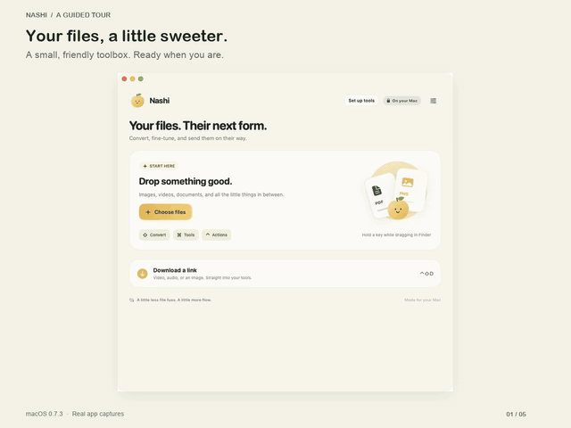
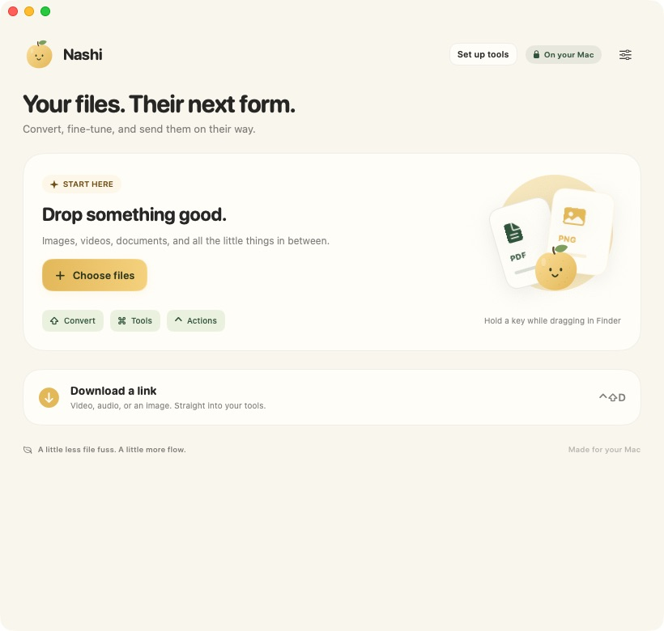
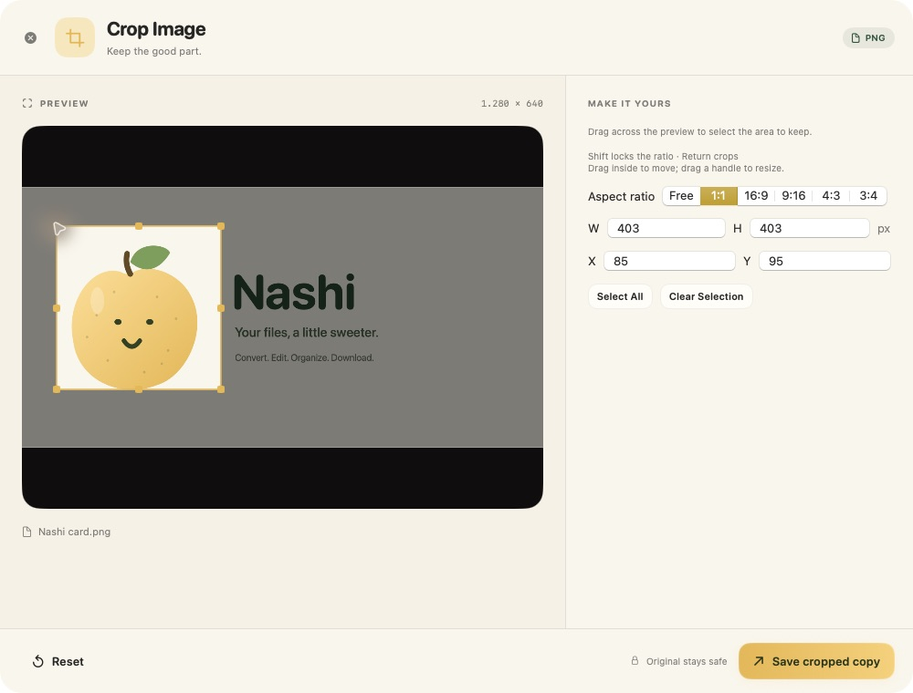
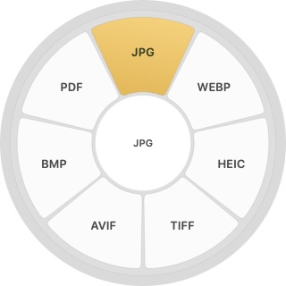
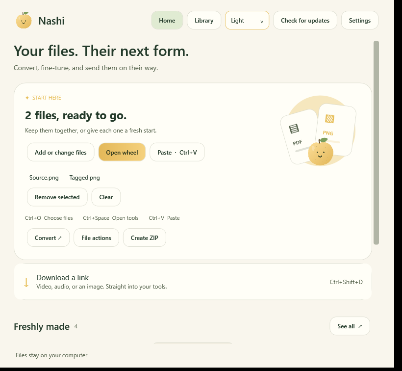

<p align="center"></p>
<h1 align="center">Nashi</h1>
<p align="center">Your files, a little sweeter. · Dosyaların için tatlı bir kolaylık.</p>

[English guide](https://orkunisitmak.github.io/nashi-app/) · [Türkçe](https://orkunisitmak.github.io/nashi-app/tr/) · [Latest release](https://github.com/orkunisitmak/nashi-app/releases/latest) · [Security](SECURITY.md)

Nashi is an independent, open-source file conversion and editing app inspired by [Tangerine](https://tangerineformac.com/)'s drag-and-wheel interaction. It adds public web-media downloads, QR reading, refined crop/annotation workflows, keyboard media editing, live progress and signed automatic updates. Nashi is not affiliated with Tangerine or LEAP STUDIO and includes no proprietary reference-app binaries or artwork.

## See Nashi in action

[](https://orkunisitmak.github.io/nashi-app/#demo)

**[Watch the 23-second demo](https://orkunisitmak.github.io/nashi-app/#demo)** · **[Türkçe demo](https://orkunisitmak.github.io/nashi-app/tr/#demo)** · [MP4](https://orkunisitmak.github.io/nashi-app/assets/showcase/nashi-demo.mp4)

A guided tour assembled from real macOS 0.7.3 app captures: choose an image, convert it to JPG, crop it and find the outputs. English and Turkish captions are available in the video player.

| macOS · Home | macOS · Crop image |
| :---: | :---: |
| [](docs/assets/showcase/mac-home.png) | [](docs/assets/showcase/mac-crop.png) |
| **macOS · Conversion wheel** | **Windows · Development preview** |
| [](docs/assets/showcase/mac-wheel.png) | [](docs/assets/showcase/windows-home-preview.png) |

Windows screenshot: native UI test capture from the development build in [PR #1](https://github.com/orkunisitmak/nashi-app/pull/1), ahead of the current public Windows release. Demo files contain Nashi's own artwork; no personal files or account details are shown.

## Download and use

- **[macOS ZIP · Apple Silicon, macOS 13+](https://github.com/orkunisitmak/nashi-app/releases/latest/download/Nashi-macOS-arm64.zip):** extract, move Nashi.app to your Applications folder and open it. The full macOS catalog has 27 tools, 45 input formats and 275 conversion routes.
- **[Windows x64 ZIP · native preview](https://github.com/orkunisitmak/nashi-app/releases/latest/download/Nashi-Windows-x64.zip):** extract the entire archive into its own writable folder, then open Nashi.exe. No separate .NET install is required. Keep the folder together so portable updates can replace the app safely. [Windows features and differences](windows/README.md).

Choose **Set up tools** once for hash-verified downloads directly from upstream. Media tools enable media conversions/previews and web downloads; macOS Office setup enables Office conversions. Core native image/PDF features work immediately. [Exact versions, hashes and licenses](docs/dependencies.md).

These first public builds do not have Apple notarization or Windows Authenticode publisher signing. Your OS may require first-launch approval; consult [Apple's guidance](https://support.apple.com/en-us/102445). Nashi does not disable system security settings. Official release assets include SHA-256 checksums. A CI artifact alone is not an official signed update.

## Shortcuts

On macOS, hold **Shift** while dragging in Finder for conversion, **Command** for tools or **Control** for file actions. **Control–Shift–D** downloads a copied public link. Drag modifiers are customizable. On Windows, use **Ctrl+O** to choose files, **Ctrl+V** to import copied files/text/images, and **Ctrl+Space** for the tools wheel. **Ctrl+2** opens Library; **Ctrl+F** searches it. Normal paste inside text fields is preserved. Home and Library share the Mac color palette, rounded cards and gold actions, with System/Light/Dark appearance.

Supported media editors use **Space** for play/pause, **Left/Right** to seek one second and **I/O** to mark a range. Crop uses drag, **Shift** for aspect lock and **Enter** to save. The [English](https://orkunisitmak.github.io/nashi-app/#shortcuts) and [Turkish](https://orkunisitmak.github.io/nashi-app/tr/#shortcuts) pages contain the complete macOS shortcut sheet; the [Windows guide](windows/README.md) lists its available controls.

## Build

For macOS: Apple Silicon, macOS 13+ and Xcode/Swift 6.

```sh
scripts/setup-exiftool.sh
swift build --product Nashi
swift test --filter NashiUpdatesTests
scripts/build-app.sh release
```

The public app is written to `build/Nashi.app`. Large runtimes are installed through its setup screen. Source builds use an ad-hoc signature unless you provide your own ignored signing profile. Signing private keys are never distributed. [Windows build instructions](windows/README.md).

## Privacy and updates

Conversion/editing run locally. Web downloads contact the selected media site. No analytics, cloud account or browser-cookie import is built in. Official releases update through this public repository without a GitHub account or token. macOS verifies the signed feed and archive; Windows verifies the archive signature and version before replacement. Active operations finish or cancel before the app exits for an update. Portable Windows updates retain the previous folder as a recoverable backup.

## License and acknowledgments

Nashi's original source is [MIT](LICENSE). Vendored libraries and external tools retain their own licenses; see [macOS notices](Resources/THIRD-PARTY-NOTICES.txt), [Windows notices](windows/THIRD-PARTY-NOTICES.txt) and [runtime setup](docs/dependencies.md). No purchase flow or reference-app account is required.
